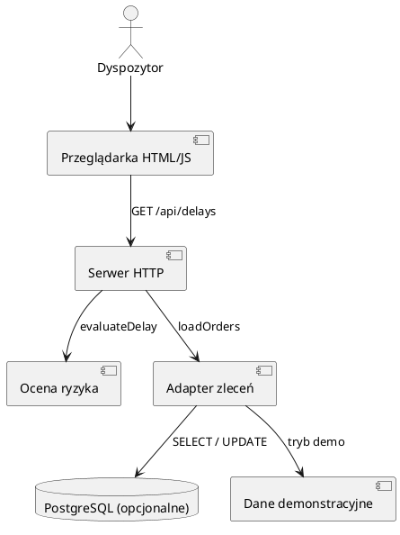
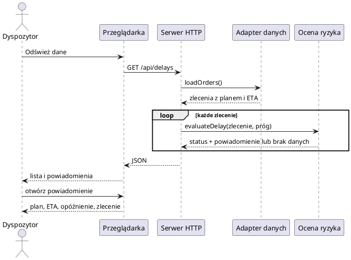
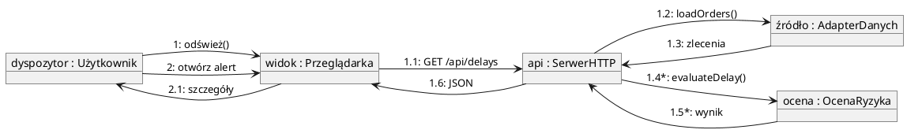
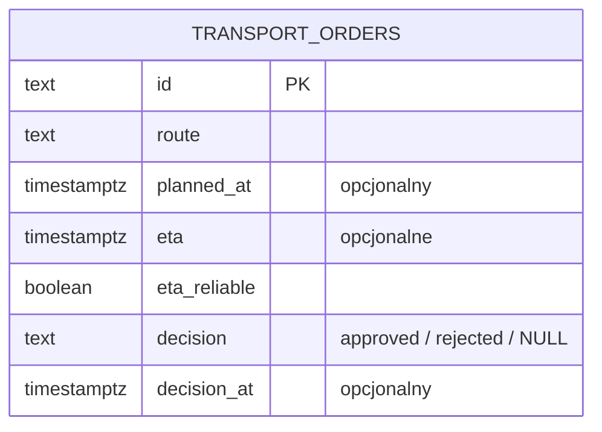
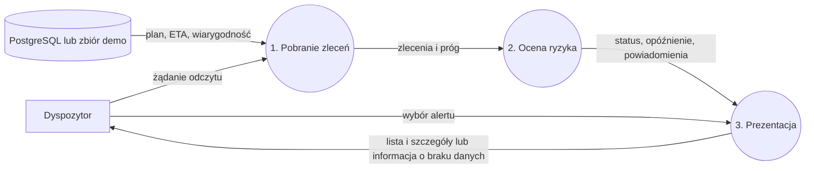
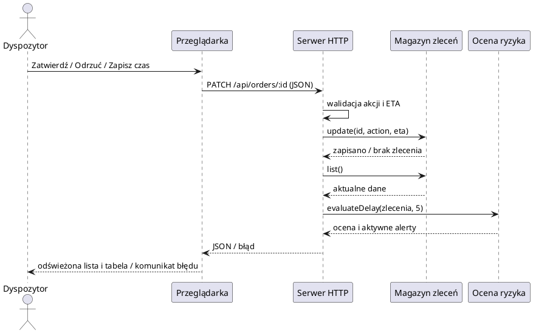

# Architektura 4+1 — prototyp FR-02

## +1: przypadki użycia

Wymagania ogólne: `specs/001-transport-dispatch/spec.md` i diagramy przypadków użycia
w `docs/`. Implementowana historia: slajd 18 oraz `specs/002-delay-alerts/spec.md`.
Dokument przedstawia wyłącznie zaimplementowany wycinek systemu.

Aktualizacja: ADR-007 rozszerza historię o decyzje i ręczną zmianę ETA. Próg 5 minut
jest regułą serwera, bez ustawienia w przeglądarce. PATCH /api/orders/:id przyjmuje
action (approve/reject/reschedule) i opcjonalne eta. Magazyn zapisuje decyzję i czas
lub aktualizuje ETA oraz czyści poprzednią decyzję. Następuje ponowna ocena
i zwrot aktualnej listy. Lokalny magazyn jest w pamięci procesu; PostgreSQL jest trwały.

## Widok deweloperski: struktura

Moduły: przeglądarka (`public/`), serwer HTTP (`src/server.js`), logika oceny
(`src/delays.js`), adapter danych (`src/orders.js`), PostgreSQL (`src/database/`).
Poniżej źródło UML Component Diagram do renderowania w PlantUML.

## Widok procesu: UML Sequence Diagram

## Widok procesu: UML Communication Diagram

## Model danych: ERD

Jeden byt przechowywany w PostgreSQL w zakresie tej historii. Ocena i powiadomienie
są obiektami wyliczanymi przy odczycie, bez osobnych tabel i relacji.

## Przepływ danych: DFD, poziom 1

## Widok fizyczny

Lokalna przeglądarka komunikuje się z jednym procesem Node.js na 127.0.0.1:3000.
Opcjonalnie proces łączy się z PostgreSQL. Nie skonfigurowano środowiska produkcyjnego,
reverse proxy, TLS ani zewnętrznego dostawcy ETA.

## Aktualizacja procesu: decyzja lub zmiana czasu

## Rozróżnienie decyzji (ADR-008)

Zatwierdzenie pozostawia wiarygodną prognozę i potwierdzone opóźnienie, usuwając
powiadomienie z kolejki uwagi. Odrzucenie zapisuje eta_reliable=false i decision=rejected;
ocena zwraca eta_update_required oraz powiadomienie o koniecznej korekcie. W tym stanie
opóźnienie ma wartość null, nie jest obliczane z odrzuconego czasu. PATCH approve
z niewiarygodnym ETA zwraca 409. Reschedule zapisuje nowe ETA, przywraca wiarygodność,
czyści decyzję i ponawia ocenę. Dotyczy magazynu w pamięci oraz PostgreSQL.
