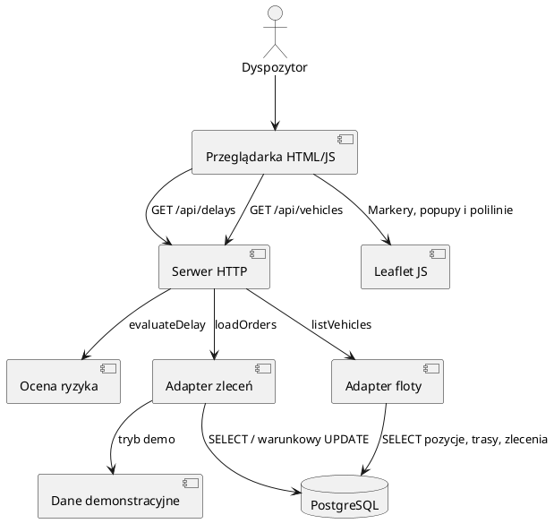
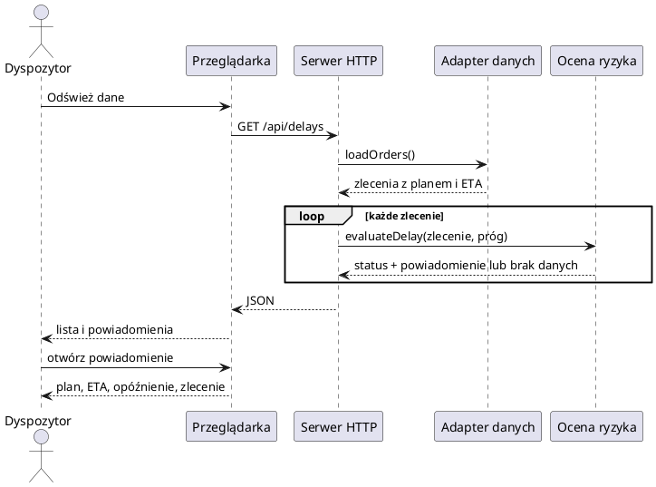
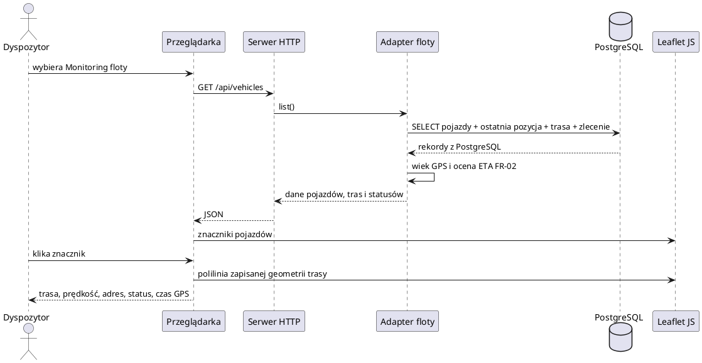
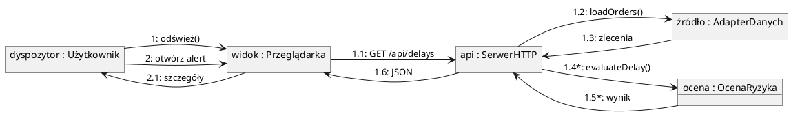
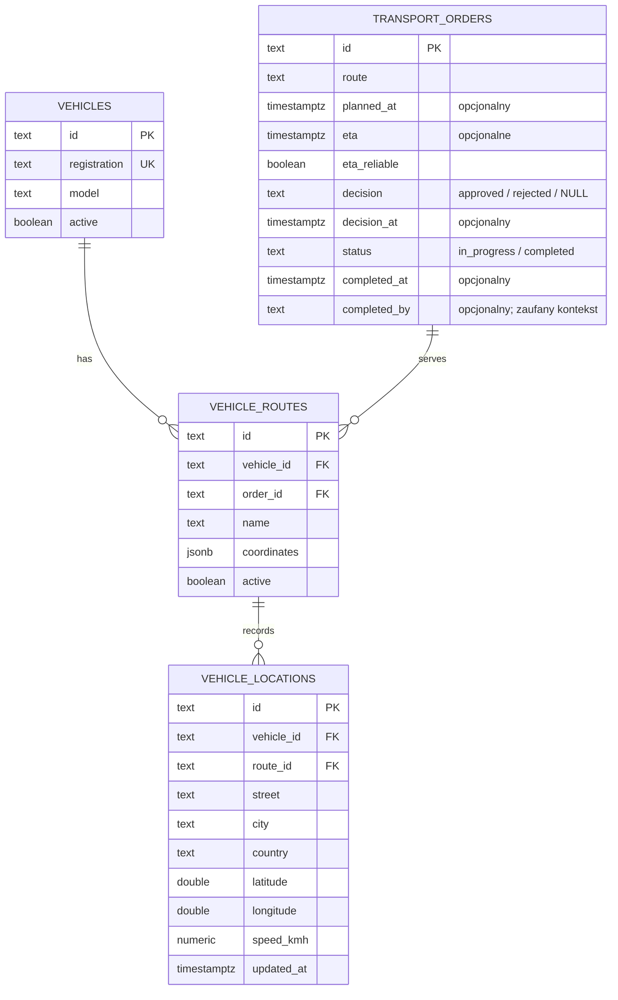
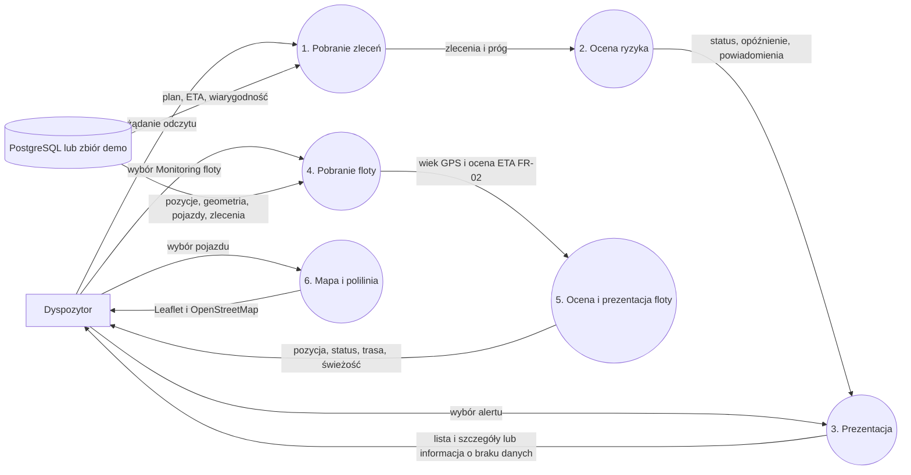
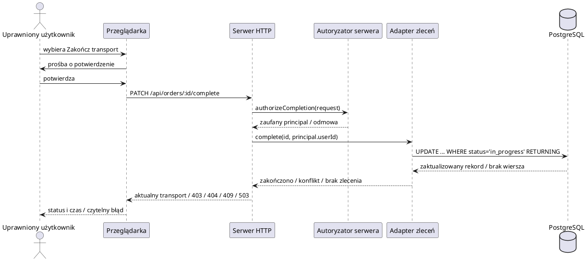
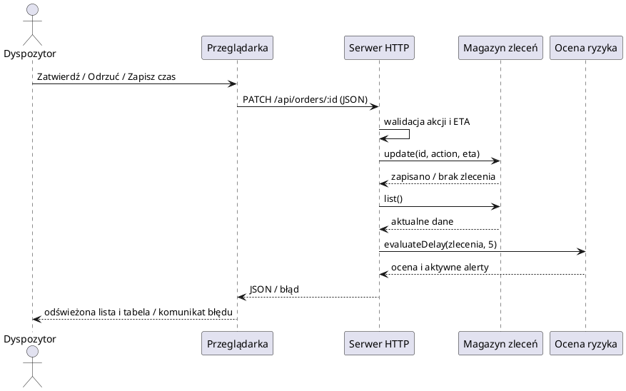

# Architektura 4+1 — FR-01 i prototyp FR-02

## +1: przypadki użycia

Wymagania ogólne: `specs/001-transport-dispatch/spec.md` i diagramy przypadków użycia
w `docs/`. Implementowana historia: slajd 18 oraz `specs/002-delay-alerts/spec.md`.
Dokument przedstawia wyłącznie zaimplementowany wycinek systemu.

Historia 3 (FR-01) umożliwia uprawnionemu użytkownikowi zakończenie zlecenia. Nie
dotyczy obsługi zgłoszeń FR-03. Zlecenie ma niezależne `transportStatus` w odpowiedzi
aplikacji oraz `status` w PostgreSQL (`in_progress` / `completed`), czas `completed_at`
i opcjonalne `completed_by`. Żądanie `PATCH /api/orders/:id/complete` wymaga
potwierdzenia w UI i serwerowej autoryzacji. PostgreSQL zmienia stan atomowo przez
warunkowy UPDATE; restart nie usuwa zapisu. Demo zachowuje zmiany do restartu procesu.
Bez logowania autoryzacja demonstracyjna jest lokalna; w trybie PostgreSQL wymaga
jawnego włączenia i działa tylko na loopback.

Monitoring tras i floty jest jedną zakładką w serwowanej stronie `public/index.html`.
`GET /api/vehicles` pobiera z PostgreSQL aktywne pojazdy, najnowszą lokalizację,
geometrię trasy oraz status i dane ETA powiązanego zlecenia. Stare tabele są zachowane,
a migracja 005 kopiuje je do tabel ERD: `company`, `app_user`, `client`, `driver`,
`vehicle`, `"order"`, `order_status_history`, `route`, `gps_location`, `report`,
`cost`, `raw_cost_data` i `external_system`.

Mapa używa lokalnego Leaflet 1.9.4 i kafelków OpenStreetMap. L.marker pokazuje pojazd,
L.popup jego szczegóły, L.polyline zapisaną geometrię planowaną, a L.featureGroup oraz
fitBounds dobierają widok. „Wszystkie pojazdy” usuwa wybór i dopasowuje granice.
Pomiar starszy niż 30 sekund jest oznaczany jako nieaktualny. Projekt nie wywołuje
routingu drogowego i nie udaje, że planowana linia jest przebiegiem po drogach.

Aktualizacja FR-02: ADR-007 rozszerza historię o decyzje i ręczną zmianę ETA. Próg 5 minut
jest regułą serwera, bez ustawienia w przeglądarce. PATCH /api/orders/:id przyjmuje
action (approve/reject/reschedule) i opcjonalne eta. Magazyn zapisuje decyzję i czas
lub aktualizuje ETA oraz czyści poprzednią decyzję. Następuje ponowna ocena
i zwrot aktualnej listy. Lokalny magazyn jest w pamięci procesu; PostgreSQL jest trwały.
Pole `status` w istniejącym wyniku FR-02 nadal oznacza ocenę ETA; stan realizacji
transportu znajduje się w `transportStatus`. Dodatkowe pole `order` w odpowiedzi
zakończenia udostępnia `status` wykonania i `delayStatus` dla oceny ETA.
Rozdzielenie zachowuje kompatybilność dotychczasowego kontraktu alertów.

## Widok deweloperski: struktura

Moduły: przeglądarka (`public/`), serwer HTTP (`src/server.js`), logika oceny
(`src/delays.js`), adapter danych (`src/orders.js`), PostgreSQL (`src/database/`).
Poniżej źródło UML Component Diagram do renderowania w PlantUML.

## Widok procesu: UML Sequence Diagram

### Monitorowanie floty

## Widok procesu: UML Communication Diagram

## Model danych: ERD

Byty PostgreSQL obejmują istniejące zlecenia, pojazdy, przypisane trasy i historię
pozycji. Ocena ryzyka ETA pozostaje wyliczana przy odczycie.

## Przepływ danych: DFD, poziom 1

## Zakończenie zlecenia: przebieg i współbieżność

Warunek statusu w pojedynczym UPDATE jest punktem synchronizacji: tylko jedno
współbieżne żądanie może zmienić rekord. Próba kolejna odczytuje istniejący rekord
i zwraca konflikt, nie nadpisując pierwotnego czasu.

## Widok fizyczny

Lokalna przeglądarka komunikuje się z jednym procesem Node.js na 127.0.0.1:3000.
W trybie demo proces korzysta z pamięci dla alertów i zakończenia; widok floty wymaga
trybu postgres i istniejącego poola `pg`. Leaflet i OpenStreetMap są ładowane bez
klucza Google. Routing drogowy nie jest skonfigurowany. Nie skonfigurowano środowiska
produkcyjnego, reverse proxy, TLS ani fizycznego dostawcy GPS/ETA.

## Aktualizacja procesu: decyzja lub zmiana czasu

## Rozróżnienie decyzji (ADR-008)

Zatwierdzenie pozostawia wiarygodną prognozę i potwierdzone opóźnienie, usuwając
powiadomienie z kolejki uwagi. Odrzucenie zapisuje eta_reliable=false i decision=rejected;
ocena zwraca eta_update_required oraz powiadomienie o koniecznej korekcie. W tym stanie
opóźnienie ma wartość null, nie jest obliczane z odrzuconego czasu. PATCH approve
z niewiarygodnym ETA zwraca 409. Reschedule zapisuje nowe ETA, przywraca wiarygodność,
czyści decyzję i ponawia ocenę. Dotyczy magazynu w pamięci oraz PostgreSQL.
